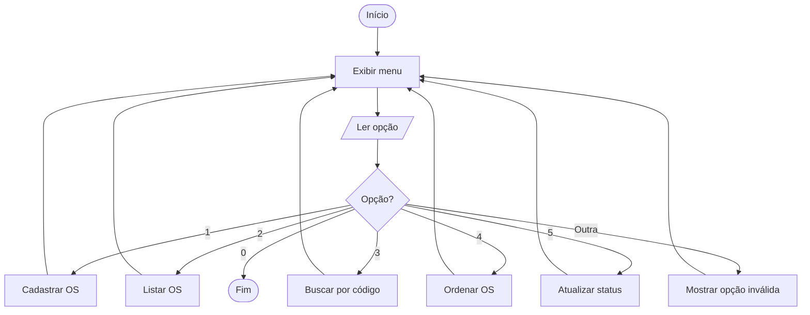

<div align="center">

# 🛠️ Gestão de Ordens de Serviço

### Sistema de manutenção industrial em **VisuAlg / Portugol**


*Cadastre, consulte, busque, ordene e atualize ordens de serviço de forma simples, padronizada e organizada.*

</div>

---

## 📑 Sumário

- [Sobre o projeto](#-sobre-o-projeto)
- [Contexto do desafio](#-contexto-do-desafio)
- [Funcionalidades](#-funcionalidades)
- [Estrutura de dados](#-estrutura-de-dados)
- [Modularização](#-modularização)
- [Fluxo principal](#-fluxo-principal)
- [Como executar](#-como-executar)
- [Casos de teste](#-casos-de-teste)
- [Padrões adotados](#-padrões-adotados)
- [Objetivos de aprendizagem](#-objetivos-de-aprendizagem)
- [Equipe](#-equipe)
- [Estrutura do repositório](#-estrutura-do-repositório)

---

## 📌 Sobre o projeto

Projeto desenvolvido no **Curso Técnico em Desenvolvimento de Sistemas (SENAI)**, na Unidade Curricular **Lógica de Programação**.

> **Situação de Aprendizagem 1 – Momento Prático 1**
> Estrutura de Algoritmos em VisuAlg: **Gestão de Ordens de Serviço**

| Item | Detalhe |
|---|---|
| 🎓 Curso | Técnico em Desenvolvimento de Sistemas |
| 📚 UC | Lógica de Programação |
| ⏱️ Carga horária | 4h |
| 👥 Dinâmica | Em grupo (3  estudantes) |
| 📦 Entrega | Arquivo `.alg` + relatório curto + demonstração presencial |

---

## 🏭 Contexto do desafio

Uma equipe de desenvolvimento apoia o **setor de manutenção de uma planta industrial**. O time recebeu a solicitação de um pequeno sistema, em forma de algoritmo, para organizar as **ordens de serviço (OS)** registradas ao longo do turno.

Os dados precisam ficar **legíveis, padronizados e fáceis de manter**, pois diferentes técnicos e analistas irão consultar e atualizar as informações.

---

## ✨ Funcionalidades

O sistema funciona por **menu de opções**:

```text
==========================================
      GESTÃO DE ORDENS DE SERVIÇO
==========================================
  1 - Cadastrar OS
  2 - Listar OS
  3 - Buscar OS por código
  4 - Ordenar OS
  5 - Atualizar status
  0 - Sair
==========================================
Escolha uma opção:
```

| # | Funcionalidade | O que faz |
|---|---|---|
| 1 | ➕ **Cadastrar** | Registra uma nova OS com validação dos dados |
| 2 | 📋 **Listar** | Exibe todas as OS cadastradas |
| 3 | 🔎 **Buscar** | Encontra uma OS pelo código |
| 4 | 🔢 **Ordenar** | Organiza por código ou por prioridade |
| 5 | 🔄 **Atualizar status** | Altera o status de uma OS existente |
| 0 | 🚪 **Sair** | Encerra o programa |

---

## 🗂️ Estrutura de dados

As OS são armazenadas em um **vetor de registros**. Cada registro possui:

| Campo | Tipo | Regra |
|---|---|---|
| `codigo` | Inteiro | Identificador da OS |
| `descricao` | Texto | Descrição do serviço |
| `prioridade` | Inteiro | Aceita apenas **1 a 3** |
| `tempo` | Inteiro | Tempo estimado, em **minutos** |
| `status` | Texto | `Aberta`, `Em andamento` ou `Concluída` |

**Prioridades**

| Valor | Significado |
|:---:|---|
| 🔴 1 | Alta |
| 🟡 2 | Média |
| 🟢 3 | Baixa |

---

## 🧩 Modularização

O código é dividido em **procedimentos e funções**, cada um com uma única tarefa:

| Módulo | Responsabilidade |
|---|---|
| `exibirMenu` | Mostra o menu principal |
| `cadastrarOS` | Lê, valida e guarda uma nova OS |
| `listarOS` | Mostra todas as OS cadastradas |
| `buscarPorCodigo` | Busca sequencial por código |
| `ordenarPorCodigo` | Ordena o vetor pelo código |
| `ordenarPorPrioridade` | Ordena o vetor pela prioridade |
| `atualizarStatus` | Muda o status de uma OS |

> ✏️ *Ajuste os nomes da tabela para ficarem iguais aos do seu arquivo `.alg`.*

---

## 🔁 Fluxo principal



**Entrada → Processamento → Saída**

- 📥 **Entrada:** opção do menu e dados da OS digitados pelo usuário
- ⚙️ **Processamento:** validações, busca, ordenação e atualização
- 📤 **Saída:** mensagens e listagem formatada na tela

---

## ▶️ Como executar

1. Baixe ou instale o **[VisuAlg](https://visualg3.com.br/)**.
2. Clone este repositório:
   ```bash
   git clone https://github.com/SEU-USUARIO/NOME-DO-REPOSITORIO.git
   ```
3. Abra o arquivo `gestao_os.alg` no VisuAlg.
4. Pressione **F9** para executar.
5. Use o menu para testar as opções.


---

## 🧪 Casos de teste

> ✏️ *Confira cada caso rodando o seu programa e ajuste as saídas se necessário. Adicione prints na pasta `docs/`.*

### ✅ Teste 1 – Cadastro e listagem

| Entrada | Saída esperada |
|---|---|
| Opção `1` → código `101`, descrição `Troca de rolamento`, prioridade `2`, tempo `90` | OS cadastrada com sucesso |
| Opção `2` | Lista mostra a OS `101` com status **Aberta** |

### ✅ Teste 2 – Validação de prioridade

| Entrada | Saída esperada |
|---|---|
| Opção `1` → prioridade `5` | Mensagem de prioridade inválida e nova solicitação do dado (aceita só 1 a 3) |

### ✅ Teste 3 – Busca e atualização de status

| Entrada | Saída esperada |
|---|---|
| Opção `3` → código `101` | Exibe os dados da OS `101` |
| Opção `5` → código `101` → novo status `Concluída` | Status atualizado com sucesso |
| Opção `3` → código `999` | Mensagem de OS não encontrada |

---

## 🧼 Padrões adotados

- **Indentação** consistente em todos os blocos
- **Comentários técnicos** explicando as partes importantes
- **Nomenclatura** clara, em `camelCase`, com nomes que dizem o que a variável ou módulo faz
- **Constantes** para valores fixos, como o limite máximo do vetor
- **Estruturas de decisão** (`se / senao`, `escolha / caso`) e **repetição** (`para`, `enquanto`, `repita`) usadas em cada situação adequada
- **Expressões** aritméticas, relacionais e lógicas aplicadas nas validações

---

## 🎯 Objetivos de aprendizagem

- [x] Aplicar lógica de programação e abstração para estruturar a solução
- [x] Representar o algoritmo com pseudocódigo e fluxograma
- [x] Usar tipos de dados, variáveis e constantes adequados
- [x] Empregar expressões aritméticas, relacionais e lógicas
- [x] Utilizar corretamente estruturas de decisão e repetição
- [x] Codificar de forma legível e padronizada
- [x] Aplicar técnicas de **busca** e **ordenação**
- [x] Trabalhar com organização, ética e método

---

## 👥 Equipe

| Integrante | Responsabilidade |
|---|---|
| **Nome 1** | Cadastro, validação e controle da quantidade de OS |
| **Nome 2** | Listagem, busca por código e atualização de status |
| **Nome 3** | Ordenação, menu principal, integração e testes gerais |

> ✏️ *Troque os nomes e, se quiser, adicione links para os perfis do GitHub.*

---

## 📁 Estrutura do repositório

```text
📦 gestao-ordens-servico
 ┣ 📜 gestao_os.alg        # Algoritmo em VisuAlg/Portugol
 ┣ 📁 docs
 ┃ ┣ 📄 relatorio.pdf      # Relatório curto (pseudocódigo/fluxograma + testes)
 ┃ ┗ 🖼️ prints/            # Evidências dos casos de teste
 ┗ 📄 README.md
```

---

<div align="center">

Feito com 💻 e muito teste de mesa no **SENAI** · Curitiba, 2026

</div>
